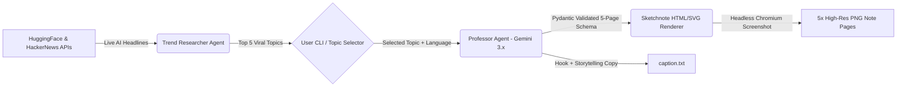

# ✍️ AI/ML Handwritten Sketchnote & Viral Content Agent


An autonomous **Multi-Agent AI Pipeline** that discovers real-time trending AI/ML topics from the web and transforms complex technical concepts into a **5-page realistic handwritten study note series (GoodNotes/Sketchnote style)** along with high-converting LinkedIn & Facebook captions.

Supports both **100% English** and **Bilingual (Sinhala + English Technical Terms)** modes to make AI/ML education accessible to both local and global audiences.

---

## 🌟 Key Features

- 🔍 **Autonomous Trend Researcher Agent:** Scrapes real-time trending AI research papers and discussions from **HuggingFace Daily Papers** and **HackerNews Algolia API** (100% free, zero paid search APIs).
- 🧠 **Professor & Content Structuring Agent:** Powered by the latest `google-genai` SDK (`Gemini 3.x Flash`) with **strict Pydantic schema validation** to guarantee 100% technically accurate, hallucination-free JSON outputs.
- 🎨 **Zero-Drift Sketchnote Rendering Engine:** Converts structured JSON into a 5-page visual study carousel featuring:
  - Cream dot-grid notebook paper with realistic lighting.
  - Locked inline SVG hand-drawn architecture diagrams, sketchy boxes, arrows, and red-pen underlines.
  - Yellow highlighter strokes and taped Post-it sticky notes.
- 🔄 **Resilient Model Fallback System:** Automatically detects active Gemini models and handles `503 Server Busy` / rate-limit spikes via smart retry and model switching.
- 📱 **Viral Copywriting Agent:** Generates authentic, human-toned social media posts with curiosity hooks, page-by-page breakdowns, and engagement questions.

---

## 🏗️ System Architecture



---

## 📸 Sample Output

| Page 01: Core Concept & Analogy | Page 02: System Architecture |
| :---: | :---: |
|  |  |

---

## 🚀 Getting Started

### 1. Clone the Repository
```bash
git clone https://github.com/YOUR_USERNAME/YOUR_REPO_NAME.git
cd YOUR_REPO_NAME
```

### 2. Install Dependencies
```bash
pip install -r requirements.txt
```

### 3. Configure Environment Variables
Create a `.env` file in the root directory and add your free Google AI Studio API Key:
```env
GEMINI_API_KEY="your_actual_gemini_api_key_here"
```

### 4. Run the Multi-Agent Pipeline
```bash
python main.py
```

---

## 📂 Project Structure

```text
├── assets/                  # Sample output images for documentation
├── output/                  # Generated 5-page note carousels & captions
├── main.py                  # Interactive CLI orchestrator for the agent pipeline
├── trend_agent.py           # Live AI/ML trend discovery agent (HF & HackerNews)
├── note_generator.py        # Gemini 3.x Pydantic generator & HTML/SVG rendering engine
├── requirements.txt         # Project dependencies
├── .gitignore               # Ignored files (.env, cache, local outputs)
└── README.md                # Project documentation
```

---

## 🛡️ License
This project is open-source and available under the **MIT License**.
