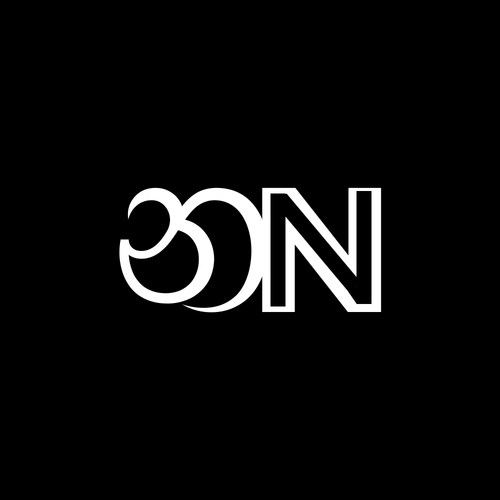
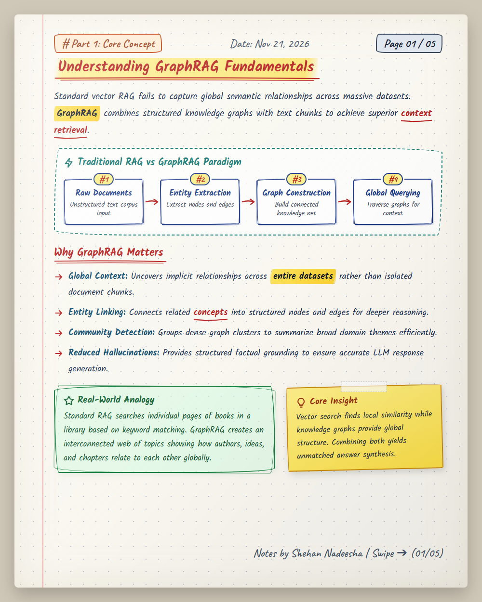
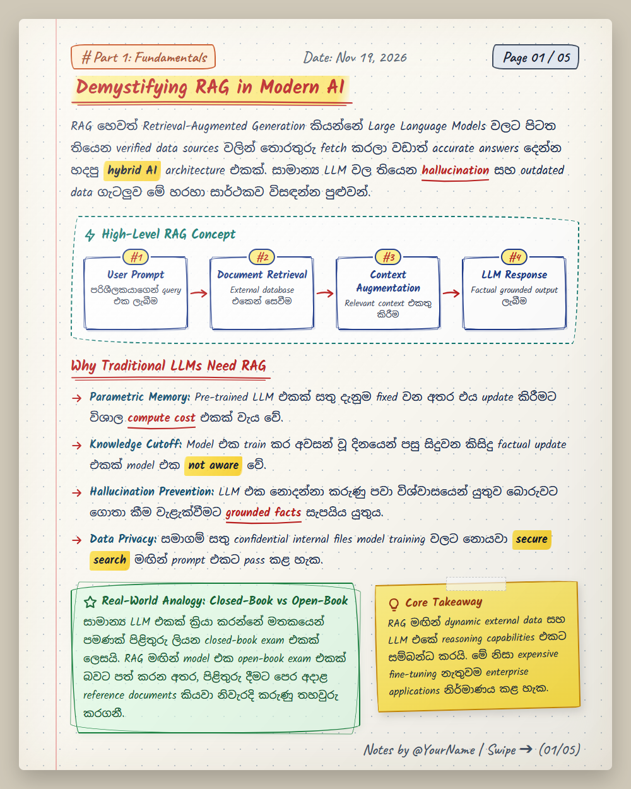
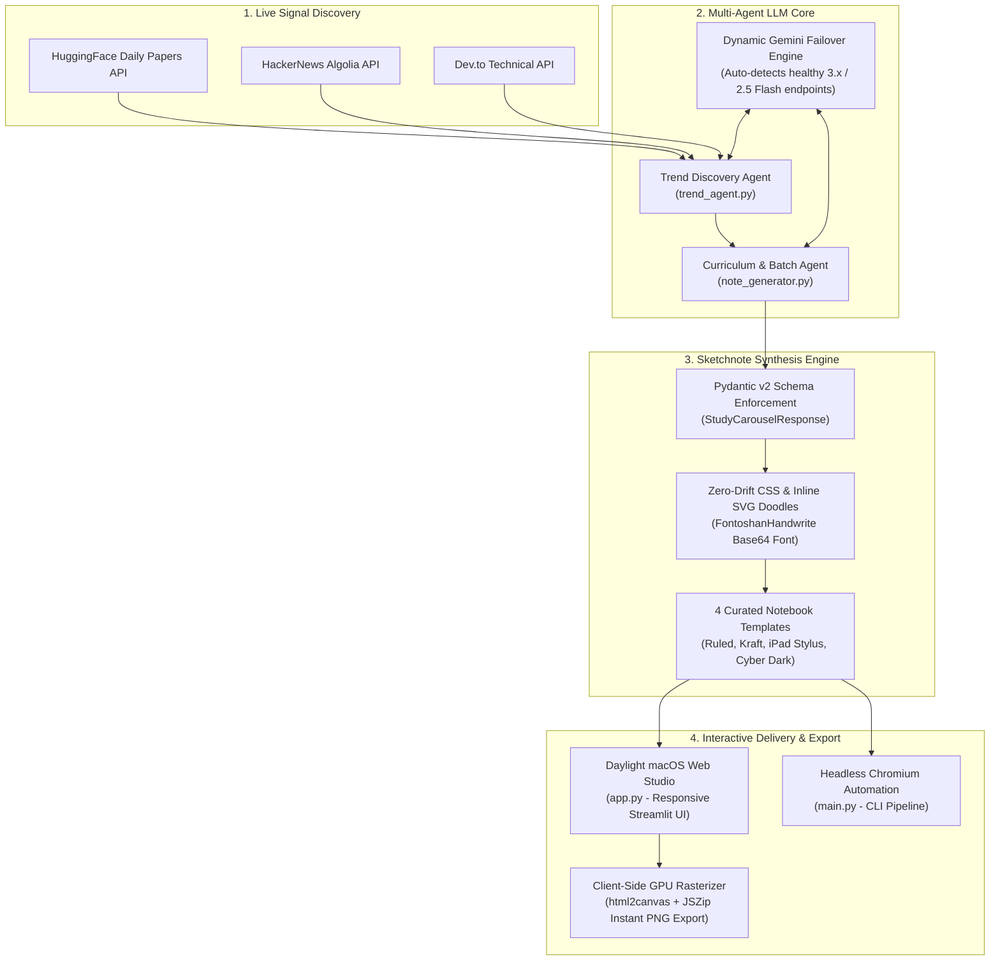

<div align="center">



# 📝 NIWNote Studio
### Autonomous Multi-Agent AI Sketchnote & Educational Carousel Engine

<b>Built by <a href="https://www.linkedin.com/in/shehan-nadeesha/">Shehan Nadeesha</a> (AI/ML Engineer)</b><br>

**Transform complex research papers and engineering breakthroughs into photorealistic, human-like handwritten study carousels & viral social media launch copy in seconds — at $0 cost.**

[](https://ai-handwritten-note-agent.streamlit.app/)
[](https://www.python.org/)
[](https://ai.google.dev/)
[](https://docs.pydantic.dev/)
[](LICENSE)

[**🚀 Launch Live Web Studio**](https://ai-handwritten-note-agent.streamlit.app/) • [**📘 Full Project Study Guide**](PROJECT_STUDY_GUIDE.md) • [**🏗️ Architecture**](#-system-architecture) • [**🎨 Themes Showcase**](#-4-handcrafted-sketchnote-themes) • [**⚡ Quick Start**](#-quick-start-local-setup)

</div>

---

## 💡 The Problem & The Solution

| The Traditional Manual Way | The NIWNote Studio Way |
|---|---|
| ⏳ **6–8 hours** reading papers, drafting notes, and sketching diagrams in Figma/GoodNotes | ⚡ **Under 30 seconds** from real-time paper discovery to fully rendered slide deck |
| 💸 **\$150–\$300** per carousel in freelance designer and copywriter fees | 🆓 **\$0 operational cost** using Google Gemini Free-Tier & client-side GPU rasterization |
| 📉 Generic AI bullet summaries that look robotic and get scrolled past | 🎨 **Authentic human handwritten notes** with organic paper textures, marker highlights, and doodle diagrams |
| 🗣️ Robotic machine translation that destroys technical context in local languages | 🇱🇰 **Sri Lankan University "Kuppi" Style** (`Sinhala_Mix`): English technical terms embedded in natural Sinhala |

---

## 📸 Sample Carousel Output

Every generation produces an ultra-sharp **5, 10, or 30-page educational carousel** (`1000x1250px` high-DPI aspect ratio), optimized for maximum viral reach on LinkedIn, Facebook, and Instagram:

<div align="center">

| 📄 Page 01 — English Academic Mode | 📄 Page 02 — Sinhala-Mix "Kuppi" Mode |
| :---: | :---: |
|  |  |
| *Classic Ruled Notebook with Ballpoint Ink & Binder Holes* | *Bilingual Technical Teaching with Highlighter & Inline Doodles* |

</div>

---

## 🏗️ System Architecture

NIWNote Studio is built on an end-to-end multi-agent pipeline designed for fault tolerance, zero hallucination, and instantaneous browser rendering:



---

## ✨ Key Engineering Highlights

### 1. 🔄 Multi-Tier Dynamic Gemini 3.x Failover
Free-tier LLM endpoints often face transient `503 Service Unavailable` spikes or quota limits. Rather than hardcoding a fragile model string, NIWNote Studio dynamically introspects your API key's active models via `get_working_models()`, prioritizing high-throughput **Gemini 3.x Flash** and **Gemini 2.5 Flash** models with automatic silent failovers.

### 2. ⚡ Zero-Drift CSS + Inline SVG Sketchnote Renderer
Standard canvas drawing libraries suffer from vertical drift when custom fonts load or text wraps across multiple lines. NIWNote Studio uses a pure CSS + Data-URI engine:
- **`box-decoration-break: clone`**: Guarantees yellow highlighter ink (`<mark>`) and ballpoint underlines stay 100% pixel-locked to target phrases.
- **Embedded Base64 Typography**: Packs `FontoshanHandwrite-Regular.ttf` and real paper textures directly into the HTML document, eliminating network font pop-in.

### 3. 🚀 Zero-Server-RAM Client-Side GPU Exporter
Headless Chrome screenshotting on cloud servers (Streamlit Cloud, AWS t2.micro) quickly triggers `Out-Of-Memory (OOM)` container crashes. NIWNote Studio offloads rendering to the **client browser** using `html2canvas` and `JSZip`:
- All 5 to 30 slides are rasterized on the client's GPU in seconds.
- Zipped and downloaded directly in-memory without putting any compute strain on the backend server.

### 4. 🇱🇰 Authentic Bilingual Technical Pedagogy (`Sinhala_Mix`)
Solves the steep learning barrier for South Asian engineering students. Literal translation often mangles technical literature; NIWNote Studio uses the university **"Kuppi"** mental model:
- Explanations are warm, intuitive, and conversational in Sinhala.
- Crucial technical keywords (`Transformer`, `KV-Cache`, `LoRA`, `RAG`, `Vector DB`) remain strictly in English to preserve career and exam readiness.

---

## 🎨 4 Handcrafted Sketchnote Themes

Choose from four distinct aesthetics engineered for maximum readability:

| Theme | Category | Visual Highlights | Ideal For |
|---|---|---|---|
| 📓 **Classic Ruled Paper** | Realistic | High-res college ruled paper, 3 binder punch holes, vertical red margin, blue ballpoint pen | University exam study notes & revision guides |
| 📜 **Engineering Quad Grid** | Realistic | Recycled brown kraft paper, sepia graph grid, scotch tape corners, burnt orange ink | Technical deep dives & architecture diagrams |
| 📱 **iPad GoodNotes Stylus** | Digital | Crisp Apple tablet canvas, battery status bar, electric blue gel ink, modern minimalist layout | LinkedIn & Twitter tech carousels |
| 💻 **Notability Cyber Dark** | Digital | AMOLED pitch slate (`#0d1117`), dot-matrix layout, glowing neon cyan & emerald stylus ink | Advanced coding, cybersecurity & AI systems |

---

## 🎓 8 University Engineering Tracks

NIWNote Studio features built-in topic discovery and signal ranking across 8 major academic disciplines:
1. 🤖 **AI & Machine Learning** (LLMs, RAG, Transformers, Model Optimization)
2. 💻 **Software Engineering & Full-Stack** (System Design, Microservices, Event-Driven Architecture)
3. 🛡️ **Cybersecurity & Ethical Hacking** (Zero-Trust, Cryptography, Penetration Testing)
4. 📊 **Data Science & Big Data** (Spark, Feature Engineering, Vector Search)
5. ☁️ **Cloud Computing & DevOps** (Kubernetes, Terraform, CI/CD, Serverless)
6. 🌐 **Computer Networks & Distributed Systems** (TCP/IP, Consensus Algorithms, Edge Computing)
7. 🤖 **IoT, Robotics & Embedded Systems** (ROS2, Edge AI, Microcontrollers)
8. 🎨 **UI/UX & Product Engineering** (Design Systems, Micro-interactions, Accessibility)

---

## 📂 Repository Structure

```text
AI_Note_Agent/
├── .streamlit/
│   └── config.toml                  # Dark theme & UI layout configuration
├── assets/
│   ├── app_logo.png                 # Studio brand emblem
│   ├── FontoshanHandwrite-Regular.ttf # Embedded Sinhala + English handwriting font
│   ├── note_page_1.png              # Showcase slide 1 (Ruled Paper)
│   ├── note_page_2.png              # Showcase slide 2 (Bilingual Mix)
│   ├── real_ruled_paper.jpg         # High-resolution photographic paper texture
│   └── real_kraft_paper.jpg         # High-resolution kraft paper texture
├── app.py                           # Daylight macOS Responsive Web Studio (Streamlit)
├── main.py                          # Interactive CLI pipeline (Headless Chromium)
├── note_generator.py                # Gemini 3.x curriculum agent & 4-theme CSS/SVG engine
├── trend_agent.py                   # Multi-source live trend discovery & signal ranking
├── packages.txt                     # Linux OS packages for Streamlit Cloud (Chromium & Fonts)
├── requirements.txt                 # Python dependencies (google-genai, streamlit, pydantic)
├── PROJECT_STUDY_GUIDE.md           # 📘 Exhaustive Technical Study Guide & Interview Q&A
└── README.md                        # Project documentation
```

---

## ⚡ Quick Start (Local Setup)

### Prerequisites
- **Python 3.11+**
- A free **Google Gemini API Key** from [Google AI Studio](https://aistudio.google.com/)

### 1. Clone the Repository
```bash
git clone https://github.com/YourUsername/AI_Note_Agent.git
cd AI_Note_Agent
```

### 2. Create Virtual Environment & Install Dependencies
```bash
python -m venv venv

# Windows
venv\Scripts\activate

# macOS / Linux
source venv/bin/activate

pip install -r requirements.txt
```

### 3. Set Up Your API Key
Create a `.env` file in the project root:
```env
GEMINI_API_KEY=your_actual_gemini_api_key_here
```

### 4. Launch the Web Studio
```bash
streamlit run app.py
```
Open [http://localhost:8501](http://localhost:8501) in your browser.

### 5. Or Run via CLI
```bash
python main.py
```

---

## ☁️ Zero-Cost Cloud Deployment

Deploy your own live instance of NIWNote Studio in 2 minutes for free on **Streamlit Community Cloud**:
1. Push your code to a private or public GitHub repository.
2. Sign in to [share.streamlit.io](https://share.streamlit.io) and select your repository.
3. Set the main file path to `app.py`.
4. Under **App Settings -> Secrets**, add:
   ```toml
   GEMINI_API_KEY = "your_gemini_api_key"
   ```
5. Click **Deploy!** `packages.txt` will automatically provision headless Chromium and Sinhala fonts on the Linux container.

---

## 📘 Comprehensive Study Guide & Interview Prep

Preparing for an AI Engineering or Full-Stack portfolio review? Check out our dedicated study guide:

👉 [**Read the Full Project Study Guide (`PROJECT_STUDY_GUIDE.md`)**](PROJECT_STUDY_GUIDE.md)

**Topics covered in the Study Guide:**
- File-by-file code walkthrough and design pattern breakdown
- Token-budget prompt engineering & anti-placeholder logic
- Real-time `ThreadPoolExecutor` parallel scraping mechanics
- 5 high-impact technical interview questions with architectural answers

---

## 🛡️ License

This project is licensed under the **MIT License** — feel free to fork, customize, and build commercial or educational products on top of it.

---

## 👤 Author

**Shehan Nadeesha**  
*AI/ML Engineer*  
🔗 **LinkedIn:** [linkedin.com/in/shehan-nadeesha](https://www.linkedin.com/in/shehan-nadeesha/)  
🐙 **GitHub:** [github.com/shehannadeesha](https://github.com/shehannadeesha)

<div align="center">
Made with ❤️ for AI researchers, educators, and university students.
</div>
