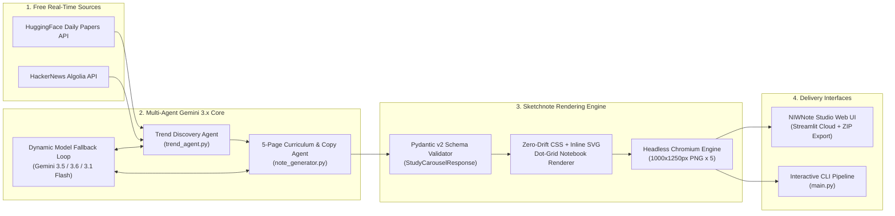

<div align="center">

#  NIWNote Studio — Autonomous AI/ML Sketchnote & Viral Copy Engine

**An end-to-end Multi-Agent AI system that autonomously discovers trending AI/ML breakthroughs, synthesizes a 5-page curriculum, renders realistic handwritten study carousels, and writes human-like social media launch copy.**

[](https://ai-handwritten-note-agent.streamlit.app/)
[](https://www.python.org/)
[](https://ai.google.dev/)
[](https://docs.pydantic.dev/)
[](https://pypi.org/project/html2image/)
[](LICENSE)

[**Launch Live Studio Web App**](https://ai-handwritten-note-agent.streamlit.app/) • [**Architecture**](#-system-architecture) • [**Sample Output**](#-sample-handwritten-carousel-output) • [**Local Setup**](#-quick-start-local-installation)

</div>

---

## Overview

Creating high-retention technical carousels for LinkedIn and Facebook typically requires hours of reading research papers, structuring a beginner-friendly curriculum, illustrating diagrams by hand, and crafting engaging copy.

**NIWNote Studio** automates this entire workflow at **$0 cost** using a multi-agent pipeline:
1. **Live Trend Discovery Agent (`trend_agent.py`):** Queries **HuggingFace Daily Papers** and **HackerNews Algolia APIs** in real time to identify high-velocity AI/ML topics.
2. **Curriculum & Copywriter Agent (`note_generator.py`):** Uses **Google Gemini 3.x Flash** models with strict **Pydantic v2** schema validation to transform complex concepts into a cohesive **5, 10, or 30-page study guide** plus an authentic, human-toned social media caption.
3. **Authentic Human Handwritten Sketchnote Studio (`note_generator.py`):** Embeds true **Sinhala + English handwriting fonts** (`FontoshanHandwrite`, `Caveat`, `Kalam`, `Maname`, `Yaldevi`) with inline SVG doodles, authentic marker highlighters, binder punch holes, scotch tape, and organic flow arrows across 4 curated styles:
   - **2 Realistic Styles:** *Classic Ruled Notebook* (loose-leaf college paper, 3-ring binder punch holes, red margin line, ballpoint pen ink) and *Vintage Kraft Journal* (recycled brown paper, sepia graph grid, burnt orange ink, scotch-taped notes).
   - **2 Digital Styles:** *iPad GoodNotes* (clean Apple Pencil tablet canvas with status bar and electric blue stylus ink) and *Notability Cyber Dark* (AMOLED slate with neon cyan & emerald glowing stylus ink).
4. **Daylight macOS Responsive Studio (`app.py`):** A fully responsive UI optimized for Desktop, Tablet, and Mobile devices with live trend scanning, miniature visual previews, interactive touch-swipe slide inspector, one-click copyable captions, and GPU-accelerated client-side `.PNG` and `.ZIP` bundle export.

---

## Sample Handwritten Carousel Output

Every run produces a **5-page progressive learning carousel** (`1000x1250px` per slide) engineered for maximum readability on mobile and desktop feeds:

| Slide 01 — ENGLISH | Slide 02 — SINHALA MIX |
| :---: | :---: |
|  |  |

---

## System Architecture



---

## Key Engineering Highlights

### 1. Dynamic Gemini 3.x Discovery & High-Availability Failover
Free-tier LLM endpoints frequently experience transient `503 UNAVAILABLE` traffic spikes or model deprecations. Instead of hardcoding a single model string, `get_working_models()` dynamically queries the active account's available models, filters out deprecated or non-text endpoints, prioritizes active **Gemini 3.x Flash** models, and automatically fails over across backup models on transient errors.

### 2. Zero-Drift CSS + Inline SVG Sketchnote Rendering
Traditional JavaScript `getBoundingClientRect()` canvas overlays suffer from vertical coordinate drift when web fonts (`Kalam`, `Noto Sans Sinhala`) load asynchronously or when highlighted phrases wrap across lines.
- **Solution:** Engineered a pure CSS + inline SVG Data-URI annotation system using `box-decoration-break: clone` and Chromium's `--virtual-time-budget=3500` deterministic paint flag.
- **Result:** Yellow highlighter strokes (`<mark>`), hand-drawn red ink boxes (`<b>`), and curved blue ballpoint underlines (`<u>`) stay 100% locked to their target words across multi-line wraps in both English and Sinhala scripts.

### 3. Bilingual Technical Pedagogy (`Sinhala_Mix` & `English`)
Supports two specialized instructional modes:
- **Sinhala + English Technical Terms (`Sinhala_Mix`):** Natural conversational Sinhala explanations paired with industry-standard English AI/ML terminology (`RAG`, `Vector Database`, `Embeddings`, `Transformer`), making advanced AI accessible to Sri Lankan students and developers.
- **Global English Mode (`English`):** 100% English technical sketchnotes for international LinkedIn/X audiences.

### 4. Typographic Glassmorphism Web Studio
Built with a custom responsive design system featuring an obsidian grid canvas (`#020504`), neon emerald accents (`#00FF88`), `Space Grotesk` + `JetBrains Mono` typography, automatic workspace hydration, and in-memory `.ZIP` packaging for one-click downloads.

---

## Repository Structure

```text
AI_Note_Agent/
├── .streamlit/
│   └── config.toml          # Studio configuration
├── assets/
│   ├── FontoshanHandwrite-Regular.ttf # Authentic Sinhala + English handwriting font
│   ├── note_page_1.png      # Sample rendered sketchnote slide 1
│   └── note_page_2.png      # Sample rendered sketchnote slide 2
├── app.py                   # Responsive Streamlit Web Studio application (Desktop / Tablet / Mobile)
├── main.py                  # Interactive CLI orchestrator
├── note_generator.py        # Gemini 3.x curriculum agent + 4 Handcrafted Templates & Client-Side GPU Renderer
├── trend_agent.py           # Multi-track university topic discovery & signal ranking agent
├── packages.txt             # Linux system dependencies (chromium, fonts-noto-core)
├── requirements.txt         # Python package dependencies
└── README.md                # Project documentation
```

---

## Quick Start (Local Installation)

### Prerequisites
- **Python 3.11+**
- **Google Chrome** or **Chromium** installed on your machine
- A free **Google Gemini API Key** from [Google AI Studio](https://aistudio.google.com/)

### 1. Clone the Repository
```bash
git clone https://github.com/YourUsername/AI_Note_Agent.git
cd AI_Note_Agent
```

### 2. Install Dependencies
```bash
pip install -r requirements.txt
```

### 3. Configure Environment Variables
Create a `.env` file in the project root:
```env
GEMINI_API_KEY=your_gemini_api_key_here
```

### 4. Launch the Web Studio (Recommended)
```bash
streamlit run app.py
```
Open `http://localhost:8501` in your browser to access the **NIWNote Studio** workspace.

### 5. Or Run the Interactive CLI
```bash
python main.py
```

---

## Cloud Deployment (Streamlit Community Cloud)

This repository is pre-configured for zero-cost hosting on **Streamlit Community Cloud**:
1. `packages.txt` automatically provisions headless `chromium`, `chromium-driver`, and `fonts-noto-core` on the Linux container.
2. `.streamlit/config.toml` enforces the **Green x Black** institutional dark theme.
3. Add `GEMINI_API_KEY = "your_key"` in your Streamlit Cloud **App Settings -> Secrets** panel and deploy `app.py`.

---

## License

Distributed under the **MIT License**. Feel free to fork, customize, and build upon this agent pipeline.
